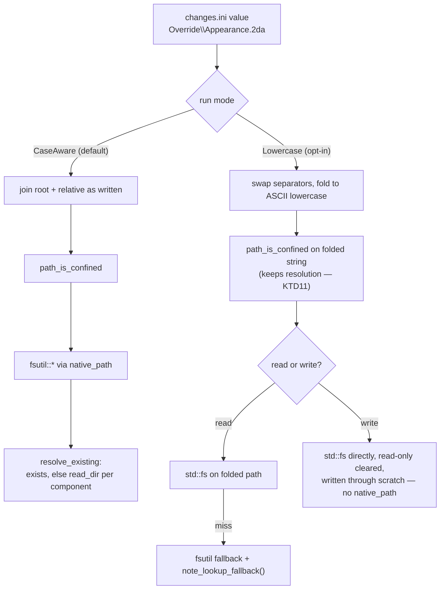
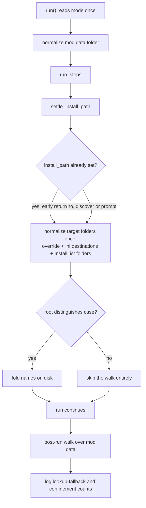

# Experimental Lowercase Lookup Keys Behind an Opt-In - Plan

## Goal Capsule

- **Objective:** A user who opts in installs a mod on a case-sensitive filesystem faster than they do today. Every user who does not opt in gets exactly today's behavior.
- **Means:** Fold ini-derived path fragments to ASCII lowercase and bypass case resolution on the write path, both behind an opt-in switch that is off by default (KTD1, KTD8). Two correctness fixes ride along because they sit in the code this work touches: the ASCII-agreement fix (R11) and the mod-folder walk fix (R12).
- **Authority:** The Requirements below win on behavior. The KTDs win on mechanism. A unit overrides neither.
- **Execution profile:** Performance work on a patcher that writes to a user's game install. The default path must come out unchanged apart from R11 and R12; `tests/install_run.rs` is the regression net. The opt-in path needs its own coverage, and every mode-dependent test must serialize against the others.
- **Stop conditions:** Stop before changing default behavior anywhere except R11 and R12. Stop and ask before lowercasing anything written into game data. Stop before renaming anything on a filesystem that does not distinguish case.

---

## Product Contract

### Summary

Add an opt-in mode that folds every path fragment the patcher derives from `changes.ini` to ASCII lowercase, normalizes the folders the mod targets, and writes through helpers that skip case resolution. With the switch off — the default — case-aware resolution runs as it does today. The mode carries counters that report what it did and did not eliminate, which is the evidence that decides whether it ever becomes the default.

### Problem Frame

`fsutil::native_path` in the `kotor-formats` dependency resolves paths the way a `CaseAwarePath` does. On non-Windows it tries `path.exists()` first; on a miss it walks each remaining path component with `read_dir` looking for a case-insensitive match. A correctly-cased path costs one `stat`. A miss costs a full `read_dir` of the deepest existing ancestor — against an `override/` folder holding thousands of entries, that is thousands of directory entries read to resolve one name.

Three things make misses the common case, not the rare one:

- Mod instruction files were written on Windows, so they say `Override\Appearance.2da`. Nothing folds that request to the casing on disk, so the cheap check misses on essentially every ini-derived path.
- Every file the mod *creates* misses by construction. `write_file` (`fsutil.rs:287`), `copy_file` (`fsutil.rs:127`), and `force_directories` (`fsutil.rs:97`) all route through `native_path`, and a file that does not exist yet cannot pass `path.exists()`. The scan then walks the existing ancestors and reads all of `override/`. Folding the request does not fix this; only skipping `native_path` on the write side does.
- `path_is_confined` (`src/patcher/files.rs:99-101`) calls `native_path` on its target, and it runs before each write (`files.rs:845`, `:895`, `:947`). That is a second per-file scan on the same not-yet-created path, and this plan does not remove it — see KTD11.

Three findings from the current tree shape the work:

- The pre-run normalization in `src/patcher/engine.rs:105-106` normalizes the wrong tree. `base_path` is the mod folder (`session.base_path`), not the game folder, though the log label says "game folder". `data_path` is `base_path/tslpatchdata/`, so the mod tree is walked twice. The post-run walk at `:112` is not a duplicate — it runs after `run_steps` and is the only walk that sees files the run created, including `base_path/backup`.
- The game folder is usually known before the run reaches it, not discovered mid-run. `settle_install_path` (`src/patcher/files.rs:255-291`) returns early when `install_path` is already set, and the GUI (`src/ui/mod.rs:360`), `--game-dir` (`src/cli/direct.rs:200`), and the test fixture (`tests/install_run.rs:73`) all preset it through `set_install_path`. Only the discovery path prompts the operator. Game-side normalization must fire on both exits.
- `force_lowercase_into` renames with Unicode `to_lowercase()` while `find_case_insensitive` and `case_insensitive_child` compare with `eq_ignore_ascii_case`. `ÄPPLE` is renamed to `äpple`, which the matcher will not match. It also deletes data on a case-insensitive filesystem: `destination.exists()` is true for the same file under a different spelling, so the merge branch compares the file with itself, finds it identical, and removes it. Both are defects in the default path and are fixed unconditionally.

### Requirements

**The switch**

- R1. Lowercase lookup keys are opt-in. The default build and the default invocation use case-aware resolution, unchanged.
- R2. With the switch off, the patcher produces the same files, the same bytes, and the same log lines it produces today, except for the correctness fixes in R11 and R12.
- R3. The switch is set by the person running the patcher, never by the mod. A `changes.ini` cannot turn it on.
- R4. The switch is discoverable: a CLI flag, an environment variable, and a GUI toggle set the same mode. Precedence is flag, then variable, then off.
- R5. A run with the switch on says so in the install log, once, and names the mode as experimental.
- R16. The mode and the counters are per-run state carried on the patcher. Nothing about them is process-global.
- R17. A run reads its mode once at entry and uses that value for the whole run.

**Path folding (opt-in mode only)**

- R6. Every path the patcher builds below a root has its relative portion folded to ASCII lowercase and its backslashes replaced with the native separator. The root the user chose — an absolute path such as `/home/user/Games/Star Wars KotOR II` — is never rewritten.
- R7. Folding happens before the path is confined. The string `path_is_confined` validates is the string that is opened.
- R8. Writes, directory creation, copies, and deletes below a normalized root go straight to `std::fs` on the folded path, without case resolution.
- R18. A write or delete that skips case resolution still clears the read-only attribute on an existing target and still writes through a scratch file renamed into place, matching `fsutil::write_file` and `fsutil::delete_file`.
- R9. A lookup that misses on the folded path still resolves through the existing case-insensitive fallback. The run records that the fallback fired.
- R19. Confinement keeps case-aware resolution in both modes, so its symlink check is unchanged. Its resolutions are counted separately from R9's lookup fallbacks.
- R10. Normalization of the game install covers only the folders the mod targets: `override`, every distinct `!Destination` and `!DefaultDestination` value, every `[InstallList]` folder value, and the parent folder of any capsule destination. It runs once per run, on either exit of `settle_install_path`.

**Correctness, both modes**

- R11. `force_lowercase` folds with ASCII case rules, matching the `eq_ignore_ascii_case` matchers, and reports a rename it could not perform instead of skipping it silently.
- R20. `force_lowercase` never deletes a file on a filesystem that does not distinguish case. It probes the root at runtime and skips the walk when case is not distinguished.
- R12. The engine walks the mod folder once before the run and once after, and each log line names the tree it actually walked. The post-run walk covers files the run created.
- R13. 2DA cell values, GFF field labels, GFF field values, token names, and 2DA column labels are unchanged in either mode.
- R14. Log lines quote file names as the mod wrote them, not as they were folded.
- R15. On a filesystem that does not distinguish case, the opt-in mode performs no renames and emits no new log lines. The gate is a runtime probe of the target root, not a compile-time platform check.

### Scope Boundaries

**In scope**

- Path fragments derived from `changes.ini`: `!SourceFile`, `!SaveAs`, `!Destination`, `!DefaultDestination`, `!SourceFolder`, `!DefaultSourceFolder`, `[InstallList]` folder values, `[Settings] Required` names, and the section names that name a file (`[2DAList]`, `[GFFList]`, `[SSFList]`, `[HACKList]`, `[CompileList]`).
- Resource names used to find or store a resource inside an ERF, MOD, or RIM.
- The normalization walk under the mod folder, and under the mod's target folders in the game install when the mode is on.

**Outside this work**

- Changing `kotor-formats`. The dependency stays at its pinned tag (KTD1).
- Making the mode the default. That decision waits on the counters from R9 and R19 (KTD8).
- Removing the per-write confinement resolution (KTD11).
- Lowercasing values written into game data (KTD4).
- Removing `resolve_existing`'s scan. It is the default resolver now (KTD5).

**Deferred to follow-up work**

- Promoting the mode to the default, once counter evidence from real mods supports it.
- Removing the confinement scan, which needs a confinement check that does not depend on case resolution to keep its symlink guarantee.
- Normalizing the game root itself so the TLK lookup in `locate_string_table` (`src/patcher/files.rs:610`) stops falling back. R10 deliberately does not reach the game root.

---

## Planning Contract

### Key Technical Decisions

- KTD1. **Fold the request, not the resolver.** Normalize ini-derived relative paths in OdyPatcher rather than changing `resolve_existing`. (session-settled: user-directed — chosen over changing `kotor-formats`: keeps the change in this repo, needs no dependency tag bump, and avoids reimplementing about twelve `fsutil` wrappers behind 254 call sites.) Governs R6.
- KTD2. **Fold with `to_ascii_lowercase`, never Unicode `to_lowercase`.** Resrefs and game file names are ASCII. Unicode folding produces names the `eq_ignore_ascii_case` matchers cannot match. Governs R11.
- KTD3. **Scope game-folder normalization to the mod's target folders.** (session-settled: user-directed — chosen over a whole-install walk at run start: a KOTOR II `StreamVoice` folder alone holds tens of thousands of entries.) Governs R10.
- KTD4. **Fold lookup keys only; leave data payloads alone.** (session-settled: user-directed — chosen over also folding resref-bearing 2DA cell and GFF field values: writing folded values into game data changes content the mod author wrote and buys no lookup speed.) Governs R13.
- KTD5. **Keep the fallback scan and count it.** A folded name is absent when a rename returned an error — the `failed` list R11 adds — or when the lookup targets a folder outside R10's set, such as the game root. A case-only *conflict* does not produce an absent name: both spellings stay on disk, including the lowercase one, so the folded lookup hits. Governs R9.
- KTD6. **One owner for folding and for filesystem entry.** `src/paths.rs` holds the fold and every filesystem helper the folded call sites use. No call site outside it calls `to_ascii_lowercase` on a path or reaches `fsutil` with an ini-derived fragment, which makes completeness checkable by grep rather than by trusting a unit list.
- KTD7. **Bypass `native_path` on the write side.** `write_file`, `copy_file`, `force_directories`, and `delete_file` all resolve through `native_path`, and a file being created cannot pass `path.exists()`, so each new file costs a full scan of its parent. In opt-in mode the parent is already normalized and the fragment is already folded, so go to `std::fs` directly — while keeping the read-only and atomic-replace semantics `fsutil` provides (R18). Governs R8.
- KTD8. **Ship it off by default.** (session-settled: user-directed — chosen over making folding the default: the mode renames files in a user's game install and depends on an on-disk invariant this codebase has never enforced, so it earns the default by evidence rather than by argument.) Governs R1, R2.
- KTD9. **The switch is a runtime option, not an ini setting.** A mod author must not be able to change the engine's resolution strategy on a user's machine. Governs R3.
- KTD10. **Prove the win with counter assertions, not wall-clock timing.** A test asserting "zero lookup fallbacks" is deterministic; a duration assertion is flaky on shared CI. The assertion is only honest while KTD6 holds. Governs R9.
- KTD11. **Confinement keeps case resolution, and its cost is counted separately.** `path_is_confined` derives its symlink guarantee from canonicalizing the nearest *existing* ancestor. Skipping resolution there would let a symlinked `Override/` escape detection whenever normalization had not reached it, so the resolution stays in both modes. It is a per-write scan the mode does not remove, tracked by its own counter so the R9 gate stays honest about what it proves. Governs R19.
- KTD12. **Carry the mode and counters on the patcher, not in a global.** The GUI builds its `Patcher` inside `thread::spawn` (`src/ui/mod.rs:345-363`), so a mode set at process startup would not reliably reach the run, and `cargo test` runs `tests/install_run.rs` in parallel threads of one process, so a global would race the default-mode tests against the opt-in one. `src/paths.rs` still owns the logic; the helpers take the mode and counters as parameters. Governs R16, R17.
- KTD13. **Gate every rename on a runtime case-sensitivity probe.** `cfg!(windows)` is a compile-time platform check standing in for a filesystem property. macOS APFS is case-insensitive by default and is in the CI matrix, and an exFAT game drive is case-insensitive on Linux. The repo already has the probe: `filesystem_distinguishes_case` (`src/tools.rs:1035`, `src/patcher/engine.rs:2513`) guards the existing `force_lowercase` tests. Governs R15, R20.

### High-Level Technical Design

Two modes through one seam. `src/paths.rs` is the seam; the per-run mode picks the branch.

Normalization order in opt-in mode. The hook sits on both exits of `settle_install_path`, because the preset-path exit is the common one:

### Assumptions

- The mod folder and the mod's target folders in the game install are the only trees whose casing the opt-in mode controls. The game root itself is not normalized, so the TLK lookup keeps falling back.
- ERF, MOD, and RIM resource lookup already compares resrefs with `eq_ignore_ascii_case` (`erf.rs:311-314`), so folding a resref before lookup is safe and changes no stored bytes.
- `Patcher::new` loads the instruction file at `engine.rs:56`, before any normalization runs. That read pays a scan in both modes. It is one lookup per run and is not worth special-casing.

### Sources

- `src/patcher/engine.rs:100-163` — pre-run and post-run normalization, and the mislabeled target.
- `src/patcher/engine.rs:965-996` — `[InstallList]` folders read as section-key values, not `!Destination` keys.
- `src/patcher/engine.rs:1528` — `fsutil::rename_file` under `!OverrideType=rename`.
- `src/patcher/files.rs:99-101` — `path_is_confined` calling `native_path` on its target.
- `src/patcher/files.rs:255-291` — `settle_install_path` and its preset-path early return.
- `src/patcher/files.rs:395-416` — `save_name`, the single place an output file name is derived.
- `src/patcher/files.rs:596-607` — `check_required_file`, an ini-derived leaf resolved through `file_exists`.
- `src/patcher/files.rs:610` — `locate_string_table`, which reads the TLK from the un-normalized game root.
- `src/tools.rs:589-705` — `force_lowercase_into`, `merge_directory`, `find_case_insensitive`.
- `src/tools.rs:1035` — `filesystem_distinguishes_case`, the existing runtime probe.
- `src/ui/mod.rs:345-363` — the GUI building its `Patcher` inside a spawned thread.
- `src/cli/mod.rs:79-130` — option parsing, where the flag lands. `:411-450` — host construction.
- `tests/install_run.rs:20-42, 52-59, 73` — fixture shape, the `fsutil`-based existence accessors, and the preset install path.
- `kotor-formats` `fsutil.rs:17-81` (`native_path`, `resolve_existing`), `:97` (`force_directories`), `:127` (`copy_file`), `:159` (`replace_with`), `:287` (`write_file`) — read-only reference; not modified.

---

## Implementation Units

Dependency order: U2 → U1 → U9 → U3 → U4 → U5 → U6 → U7 → U8. U-IDs are stable and are not renumbered to match that order.

### U1. Paths module: fold, filesystem helpers, per-run mode and counters

- **Goal:** One owner for ASCII folding, every filesystem entry point the folded call sites use, and the two counters.
- **Requirements:** R6, R8, R9, R16, R18, R19.
- **Files:** `src/paths.rs` (new), `src/lib.rs`.
- **Approach:** Add a module exposing:
  - `Mode` (`CaseAware`, `Lowercase`) with `CaseAware` as `Default`. No global holder — per KTD12 the mode travels as a parameter, and `Patcher` owns the value.
  - `Counters { lookup_fallbacks, confinement_resolutions }`, also owned by `Patcher` and passed in. Not an `AtomicUsize` global.
  - `fold(name) -> String` — swap `\` for the native separator, then ASCII lowercase (R6). The separator swap is not optional: `native_path` does it today (`fsutil.rs:17-23`) and KTD7's bypass skips it, so without it a capsule destination becomes a literal `modules\danm13.mod` file in the game root.
  - `under(root, relative, mode) -> String` — trailing-delimiter root plus relative; folds the relative half only in `Lowercase`, never the root.
  - Filesystem helpers taking the mode and counters: `exists`, `dir_exists`, `read`, `write`, `create_dir_all`, `copy`, `delete`, `rename`. In `CaseAware` each delegates to its `fsutil` counterpart, so behavior is today's. In `Lowercase`, reads try `std::fs` on the folded path first and fall back to `fsutil` with `note_lookup_fallback()` on a miss; writes, directory creation, copies, deletes, and renames go to `std::fs` with no `fsutil` call.
  - `resolve_for_confinement(path, counters)` — keeps `native_path` in both modes per KTD11 and calls `note_confinement_resolution()`.
- **Execution note:** The `Lowercase` write path must not be a bare `std::fs::write`. Match `fsutil`'s semantics or the mode will fail on read-only Steam and GOG installs and can leave half-written game data: create missing parents, clear the read-only attribute on an existing target, and write through a scratch file renamed into place (`fsutil.rs:159` `replace_with`). The same read-only clearing applies to `delete`, and `copy`'s source half stays a read.
- **Test scenarios:**
  - `fold("Appearance.2DA")` returns `appearance.2da`.
  - `fold("Modules\\Danm13.mod")` returns `modules/danm13.mod` on non-Windows — the separator swap, not just the case fold.
  - `fold("ÄPPLE.UTC")` lowercases only the ASCII characters, matching what `eq_ignore_ascii_case` accepts.
  - `under("/Games/KotOR II/", "Override\\Appearance.2da", Lowercase)` yields `/Games/KotOR II/override/appearance.2da`, root capitals and spaces intact; in `CaseAware` it returns the fragment as written.
  - `under` on a root with no trailing delimiter produces exactly one separator.
  - `write` in `Lowercase` creates a missing parent, overwrites a read-only destination, and does not consult `fsutil`.
  - `copy` in `Lowercase` overwrites a read-only destination, matching `fsutil::copy_file`.
  - `delete` in `Lowercase` removes a read-only file.
  - `rename` in `Lowercase` renames within a folder without consulting `fsutil`.
  - `read` in `Lowercase` against a mixed-case on-disk name falls back, succeeds, and increments `lookup_fallbacks` by one. Guard with `filesystem_distinguishes_case`.
  - `resolve_for_confinement` increments `confinement_resolutions` and leaves `lookup_fallbacks` at zero.
- **Verification:** `cargo test --no-default-features --all-targets`.

### U2. Make the renamer safe and agree with the matchers

- **Goal:** `force_lowercase` produces names the matchers accept, never deletes on a case-insensitive filesystem, and reports renames it could not perform.
- **Requirements:** R11, R20.
- **Files:** `src/tools.rs`.
- **Approach:** Three changes to `force_lowercase_into` and its helpers:
  - Replace `name.to_lowercase()` with ASCII folding (KTD2). `find_case_insensitive` keeps `eq_ignore_ascii_case`, now consistent with the renamer.
  - Probe the root once with the existing `filesystem_distinguishes_case` (`src/tools.rs:1035`) and return an empty report without walking when case is not distinguished (KTD13, R20). Without this the merge branch is reached for the *same* file under a different spelling — `destination.exists()` is true, `files_are_identical` compares the file with itself, and `remove_file` deletes the user's data. The GUI already points this function at a game folder (`src/ui/browse.rs:178`), so the exposure is not hypothetical.
  - Add a `failed: Vec<(PathBuf, String)>` field to `LowercaseReport` for a rename, merge, or removal that returned an error, and include it in `is_clean()`.
  This lands in both modes because it is a correctness fix, not part of the experiment.
- **Execution note:** Every scenario asserting a rename happened, or that a mixed-case name survived, must be guarded by `filesystem_distinguishes_case` — CI runs `macos-latest`, where APFS is case-insensitive by default. The existing `force_lowercase` tests already do this at `src/tools.rs:1085, 1106, 1131, 1159`; follow that shape.
- **Test scenarios:**
  - A file named `ÄPPLE.UTC` becomes `ÄPPLE.utc`, and `find_case_insensitive` for `äpple.utc` does not match it — documenting the boundary rather than pretending non-ASCII is handled.
  - `Appearance.2da` with no lowercase sibling is renamed and counted in `renamed`.
  - Byte-identical `Spells.2da` and `spells.2da` merge; `merged` is 1 and `conflicts` is empty.
  - Differing `Spells.2da` and `spells.2da` leave both on disk and report one conflict.
  - A rename that fails on a read-only parent appears in `failed` and makes `is_clean()` false.
  - On a root where `filesystem_distinguishes_case` is false, the report is empty and no file is removed — assert the file count before and after are equal.
- **Verification:** `cargo test --no-default-features --all-targets`; existing `src/tools.rs` tests at lines 1054-1170 still pass.

### U3. Fold at the FileHandler boundary

- **Goal:** Every path `FileHandler` builds below a root goes through `src/paths.rs`, confinement validates the string that is opened, and logs keep as-written names.
- **Requirements:** R6, R7, R14, R19.
- **Files:** `src/patcher/files.rs`, `src/patcher/engine.rs`.
- **Approach:** Route these through `paths::under` or `paths::fold`, which no-op in the default mode:
  - `save_name` returns the on-disk name. Add a separate accessor returning the name as the mod wrote it.
  - `output_folder(dest)` before joining `dest` to `install_path`.
  - `prepare_archive_member` for the capsule destination and the working-copy name under `erfpatch_temp`.
  - `locate_string_table` for `filename`.
  - `backup_current` and `backup_destination` for the name under the backup folder.
  - `resolve_source_folder` for `requested`.
  Move the fold ahead of the `path_is_confined` call on `destination_path` in `execute` so both operate on one string, and route `path_is_confined`'s own `native_path` calls through `paths::resolve_for_confinement` (KTD11). `is_safe_relative_path`, `is_safe_leaf_name`, and `contains_parent_component` keep running on the value as written. Replace direct `fsutil::` calls in this file with the `src/paths.rs` helpers.
  For R14, the as-written accessor has to reach the engine too, not just `files.rs`: `src/patcher/engine.rs` formats `save_as` into user-facing text at `:1093`, `:1115`, `:1155`, and `:1176`, and the backup lines at `:502`, `:596`, `:694`, and `:926` read `self.files.file_name()`, which `files.rs` reassigns to the folded name at `:731`, `:866`, `:920`, `:963`, and `:1001`. Switch those to the as-written accessor.
- **Test scenarios:**
  - Opt-in: an `[InstallList]` naming `Override` and `Appearance.2DA` writes `override/appearance.2da`.
  - Opt-in: `!SaveAs=MyItem.UTI` writes `myitem.uti`, and the install log still shows `MyItem.UTI`.
  - Opt-in: `!SourceFolder=ExtraFiles` resolves under `tslpatchdata/extrafiles/`.
  - Opt-in: a capsule destination `Modules\Danm13.mod` locates `modules/danm13.mod` and inserts the member under its folded resref.
  - Opt-in: an "already exists in the override folder" warning quotes the mod's casing, not the folded name.
  - Both modes: a destination of `..\..\etc` is refused, and the message quotes the value as written.
  - Both modes: a symlinked destination folder pointing outside the game root is refused — the confinement check still resolves case.
  - Default: the existing `tests/install_run.rs` expectations hold unchanged.
- **Verification:** `cargo test --no-default-features --all-targets`.

### U4. Route the sites outside FileHandler

- **Goal:** Path fragments that do not pass through `FileHandler::execute` use the same seam.
- **Requirements:** R6, R13.
- **Files:** `src/patcher/engine.rs`, `src/patcher/scripts.rs`, `src/tools.rs`, `src/session.rs`, `src/patcher/config.rs`.
- **Approach:** Route through `src/paths.rs`: `Patcher::file_destination`; the `[InstallList]` folder values and target path at `engine.rs:965-996`; the `!OverrideType=rename` path at `engine.rs:1528`, which is `paths::rename`'s consumer; `check_required_file` at `files.rs:596-607`; the script source and output names in `src/patcher/scripts.rs`; the ini-derived path builders in `src/tools.rs` (lines 31-35, 333, 442, 483); `src/session.rs:146`; and `src/patcher/config.rs:255`. Leave every other ini value alone: 2DA column labels, GFF field labels, token names, and cell values are not path fragments, and folding them would violate R13. The completeness check is KTD6's grep, not this list.
- **Test scenarios:**
  - Opt-in: a `[CompileList]` entry named `K_Script.nss` compiles and writes `k_script.ncs`.
  - Opt-in: `!OverrideType=rename` against an existing `Appearance.2da` renames it to `old_appearance.2da` and the log quotes the mod's casing.
  - Opt-in: a `[Settings] Required` entry named `Patcher.exe` resolves against the folded name.
  - Opt-in: a validation run over a mod with mixed-case `!SourceFile` values reports no missing files.
  - Both modes: a GFF step whose field label is `Mod_Entry_List` leaves the label untouched in the written file.
  - Both modes: a 2DA step setting a cell to `N_CommonerF` writes that value verbatim.
- **Verification:** `cargo test --no-default-features --all-targets`.

### U5. Fix the normalization target; add scoped game normalization

- **Goal:** The mod folder is walked correctly in both modes, and in opt-in mode the mod's target folders in the game install are normalized before the first lookup into them.
- **Requirements:** R10, R12, R15.
- **Files:** `src/patcher/engine.rs`, `src/patcher/files.rs`.
- **Approach:** Two halves, one unconditional and one gated.
  - Unconditional (R12): drop only the pre-run `normalize_case(base_path)` at `engine.rs:106` — `data_path` sits inside `base_path`, so it duplicates the line-105 walk, and its "game folder" label is wrong. **Keep the post-run walk at `:112`**, retargeted from `base_path` to `data_path` plus the backup folder, with a corrected label. It is not a duplicate: it runs after `run_steps` and folds files the run created.
  - Gated on `Mode::Lowercase` (R10): put a `normalized_game_folders: bool` guard on `FileHandler`, not `Patcher` — `settle_install_path` is a `FileHandler` method with no access to `Patcher`. Run the target-folder normalization on **both** exits of `settle_install_path`: the early return at `files.rs:260-262` when `install_path` is already set, and the discovery path. The early return is the common case — the GUI, `--game-dir`, and the test fixture all preset the path — so a hook only on the discovery path would normalize nothing. Collect the target set from `ctx.ini` (`files.rs:144`) via `IniFile::section_names()`: `override`, `!Destination` and `!DefaultDestination` values, `[InstallList]` folder values, and capsule destination parents. Skip the walk when `filesystem_distinguishes_case` is false (KTD13, R15).
- **Execution note:** Every "the mixed-case name survived" or "nothing was renamed" assertion must list the parent with `std::fs::read_dir` and compare names byte for byte. The fixture's existing accessors (`tests/install_run.rs:52-59`) go through `fsutil::file_exists`, which resolves case-insensitively — `file_exists(".../StreamVoice")` returns true after the entry has been renamed to `streamvoice`, so the assertion would pass either way.
- **Test scenarios:**
  - Opt-in: a game folder with `Override/Appearance.2da` and `Modules/Danm13.mod`, and an ini naming both destinations, has both folders normalized and the mod installs.
  - Opt-in: an ini whose `[InstallList]` names `StreamMusic` writes into the pre-existing mixed-case `StreamMusic/` rather than creating a lowercase sibling.
  - Opt-in: a `StreamVoice` folder the ini does not name keeps its exact name — assert via `read_dir`, not `file_exists`.
  - Opt-in: a run whose install path was preset via `set_install_path` still normalizes the target folders.
  - Opt-in: `settle_install_path` called more than once normalizes once.
  - Opt-in on a root where `filesystem_distinguishes_case` is false: nothing is renamed.
  - Default: no folder under the game install is renamed — assert via `read_dir`.
  - Both modes: a file the run writes into the mod folder is folded by the post-run walk.
  - Both modes: the mod-data folder is walked once before the run, not twice.
- **Verification:** `cargo test --no-default-features --all-targets`.

### U6. Surface the mode and the counters

- **Goal:** A user can see that the experimental mode ran, how often it fell back, and how much scanning it did not remove.
- **Requirements:** R5, R9, R16, R19.
- **Files:** `src/patcher/engine.rs`, `src/paths.rs`.
- **Approach:** `run()` reads its mode once at entry into a run-local value (R17), zeroes the per-run counters, and when the mode is on emits one notice naming it as experimental (R5). At the end of the run, emit one verbose line carrying both counts when either is above zero, naming them separately so the confinement residual is not mistaken for a lookup fallback. Keep both out of the warning and error tallies. Emit nothing in default mode.
- **Test scenarios:**
  - Opt-in against a normalized tree with a mixed-case ini: the experimental notice appears and `lookup_fallbacks` is zero.
  - Opt-in with a mixed-case file whose rename failed under a read-only parent: `lookup_fallbacks` is nonzero and the line appears. A case-only content conflict is *not* a valid fixture here — both spellings survive, so the folded lookup hits (KTD5).
  - Opt-in: `confinement_resolutions` is above zero for a run that writes any file, and is reported separately.
  - Default: neither line appears, and `PatchSummary` counts are unchanged.
  - Two `Patcher` instances in one process keep independent counters.
- **Verification:** `cargo test --no-default-features --all-targets`.

### U7. Prove both modes

- **Goal:** One test proves the opt-in mode fires no lookup fallbacks; one proves the default mode is unchanged.
- **Requirements:** R2, R9.
- **Files:** `tests/install_run.rs`.
- **Approach:** Add two tests over one fixture: a synthetic game folder with a populated `override/` (a few hundred files is enough — the assertion is on the counter, not the clock) and a `changes.ini` using Windows casing throughout (`Override\Appearance.2DA`, `!SaveAs=MyItem.UTI`, a `Modules\Danm13.mod` capsule destination, a `[CompileList]` entry, an `[InstallList]` folder).
  - Opt-in: construct the `Patcher` with `Mode::Lowercase`, assert `lookup_fallbacks == 0` alongside the content assertions, and record `confinement_resolutions` without gating on it. Seed the fixture's `dialog.tlk` already lowercase — R10 does not normalize the game root, so a mixed-case TLK would fall back by design (see Deferred).
  - Default: run the same fixture with the mode off, assert the same installed content and, via `read_dir`, that no game-folder entry was renamed.
  Add the `read_dir`-based exact-name accessor to the fixture; the existing `file_exists` accessors cannot distinguish renamed from not-renamed. Record the manual timing procedure in a comment: populate `override/` with 20,000 files, then time `--install` with the flag off and on.
- **Execution note:** Because the mode and counters are per-run state on `Patcher` (KTD12), these tests need no global serialization. If an implementer reaches for a global instead, both tests become order-dependent under `cargo test`'s default thread-parallel run and the R9 gate stops meaning anything.
- **Test scenarios:**
  - Opt-in, normalized tree: zero lookup fallbacks, every file at its folded path.
  - Opt-in, tree seeded with a rename that could not be performed: the run still installs correctly and the count is nonzero.
  - Opt-in, capsule target: the member is inserted and the count stays zero.
  - Default, same fixture: identical installed bytes and no renames under the game folder, asserted by exact name.
- **Verification:** `cargo test --no-default-features --all-targets`.

### U8. Document the mode

- **Goal:** A user knows the mode exists, that it is experimental, how to turn it on, and what it does to their files.
- **Requirements:** R1, R3, R4, R5, R13.
- **Files:** `docs/instructions.md`, `README.md`, `CHANGELOG.md`.
- **Approach:** Add a short section to `docs/instructions.md`: the mode is off by default; it is set by the person running the patcher and not by a mod; turning it on renames files to lowercase in the mod folder and in the folders the mod targets under the game install, and does nothing on a filesystem that does not distinguish case; values written into game data keep the casing the mod author wrote. Name the flag and the environment variable in `README.md`. Add a `CHANGELOG.md` entry covering the new mode and both default-path fixes (R11's ASCII fold and case-insensitive deletion guard, R12's walk change). Keep each to a few sentences.
- **Test expectation:** none — documentation only.
- **Verification:** review the rendered markdown.

### U9. The opt-in switch

- **Goal:** Three surfaces set one per-run mode, with a stated precedence, and none of them is reachable from a mod.
- **Requirements:** R1, R3, R4, R16, R17.
- **Files:** `src/cli/mod.rs`, `src/cli/direct.rs`, `src/main.rs`, `src/ui/browse.rs`, `src/ui/mod.rs`, `src/patcher/engine.rs`.
- **Approach:** Add `--experimental-lowercase-paths` to `cli::parse` (`src/cli/mod.rs:79-130`, beside the existing `--install` and `--validate` arms) and read `ODYPATCHER_EXPERIMENTAL_LOWERCASE_PATHS` as a fallback. Resolve the value once, then set it as a field on the constructed `Patcher` — in `src/cli/mod.rs:444`, `src/cli/direct.rs:199`, and inside the GUI's spawned thread at `src/ui/mod.rs:358`. Do not add a process-global setter (KTD12). Precedence is flag, then variable, then off (R4). Add a checkbox to the GUI tools view beside the existing "Force lowercase" action, labeled experimental, that sets the value the spawned run reads; disable it while a patch is in progress so the run's mode cannot change under it (R17). Do not read the mode from `[Settings]` or any ini key (KTD9, R3).
- **Execution note:** Resolve the environment variable once at startup rather than per lookup — `std::env::set_var` is not thread-safe, and tests that set it would otherwise race.
- **Test scenarios:**
  - The flag alone yields `Mode::Lowercase` from the resolver.
  - The variable alone yields `Mode::Lowercase`.
  - The flag wins when the variable is set to a conflicting value.
  - Neither set yields `Mode::CaseAware`.
  - A `changes.ini` carrying a key that looks like the switch does not change the mode.
  - `--help` lists the flag and marks it experimental.
- **Verification:** `cargo test --no-default-features --all-targets`; `cargo build --features gui`.

---

## Verification Contract

| Gate | Command | Applies to |
|---|---|---|
| Tests | `cargo test --no-default-features --all-targets` | U1-U7, U9 |
| MSRV | `cargo +1.77.2 test --no-default-features --all-targets` | U1-U7, U9 |
| Lints | `cargo clippy --no-default-features --all-targets -- -D warnings` | U1-U7, U9 |
| Format | `cargo fmt --check` | all |
| GUI build | `cargo build --features gui` | U5, U9 |
| Win7 target | `cargo build --release --no-default-features --target i686-pc-windows-msvc` | U1-U7, U9 |

CI runs the test job on `ubuntu-latest`, `windows-latest`, and `macos-latest`. macOS is case-insensitive by default, so a rename assertion that is not guarded by `filesystem_distinguishes_case` fails there.

Exit criteria:

- **Default path unchanged (R2):** the pre-existing `tests/install_run.rs` cases pass without edits, and the U7 default-mode case produces identical installed bytes with no renames under the game folder, asserted by exact name. The only permitted default-path differences are R11 and R12, each pinned by its own tests.
- **Opt-in path fires no lookup fallbacks (R9):** the U7 opt-in case reports `lookup_fallbacks == 0`. This is the deterministic stand-in for "no lookup scans fired", and it holds only while KTD6 does.
- **Known residual, reported not gated (R19):** `confinement_resolutions` is expected to be non-zero — roughly one per file written. The mode does not remove it (KTD11). Record the number; do not assert on it.
- **Measured win (optional, for the release note):** 20,000 files in `override/`, `--install` timed with the flag off and on. Not a CI gate. Worth taking before any decision to promote the mode, since KTD11's residual caps the achievable gain.

---

## Definition of Done

**Global**

- All verification gates pass, including MSRV and the Win7 target build.
- With the mode off, `tests/install_run.rs` passes unchanged except for the added U7 cases.
- `grep -rn 'fsutil::' src --include=*.rs` shows path-taking calls only inside `src/paths.rs`, apart from calls whose argument is a root the user supplied rather than an ini-derived fragment (KTD6). Every remaining exception carries a comment naming why.
- No path fragment is folded with Unicode `to_lowercase`; `to_ascii_lowercase` on a path appears only in `src/paths.rs` and `src/tools.rs` (KTD2).
- No process-global mode holder and no global counter exist anywhere in the diff (KTD12).
- Every test asserting a rename occurred, or that a mixed-case name survived, is guarded by `filesystem_distinguishes_case` and asserts exact names via `read_dir` (KTD13).
- No 2DA cell value, GFF field label, GFF field value, 2DA column label, or token name is folded anywhere in the diff (R13).
- Install log lines quote file names as the mod wrote them, in both modes and in both `files.rs` and `engine.rs` (R14).
- No abandoned experimental code remains — in particular, no second folding helper outside `src/paths.rs`.

**Per unit**

| Unit | Done when |
|---|---|
| U1 | `src/paths.rs` exists, is registered in `src/lib.rs`, holds the fold, the helpers, and the counters, takes mode and counters as parameters, preserves read-only and atomic-replace semantics on the bypass, and its tests pass. |
| U2 | `force_lowercase` folds with ASCII rules, skips entirely on a case-insensitive root, and reports failed renames; `is_clean()` accounts for them. |
| U3 | Every `FileHandler` path builder goes through `src/paths.rs`, confinement resolves through `resolve_for_confinement`, and both `files.rs` and `engine.rs` log as-written names. |
| U4 | Engine destination, `[InstallList]`, `!OverrideType=rename`, `check_required_file`, script, session, config, and validation path sites go through `src/paths.rs`; no data-carrying value does. |
| U5 | The duplicate pre-run walk is gone, the post-run walk survives retargeted to `data_path` plus backup, and target-scoped game normalization runs once on both exits of `settle_install_path`, skipped on a case-insensitive root. |
| U6 | A run in opt-in mode names the mode once and reports both counters separately; a default run emits neither; two patchers in one process do not share counts. |
| U7 | Both regression tests pass: zero lookup fallbacks in opt-in mode, identical output and no renames in default mode, both asserted by exact name. |
| U8 | `docs/instructions.md`, `README.md`, and `CHANGELOG.md` describe the mode, its precedence, and both default-path fixes. |
| U9 | Flag, variable, and GUI toggle set one per-run mode with flag-then-variable precedence, no global setter exists, and no ini key can reach it. |
